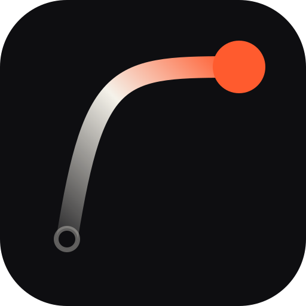

# kinetics-ui

Motion decisions for your coding agent. It picks the easing, duration, origin and technique for every animation in a web UI, and tells you when not to animate at all.

[](https://www.npmjs.com/package/kinetics-ui)
[](./LICENSE)

```sh
npx kinetics-ui
```

Restart your agent session, then ask for an animation as you normally would. Works with CSS, Tailwind, Framer Motion and Vue/React.

## Why

Ask an agent for a transition with no other guidance and the same problems show up: bounce on UI you use all day, linear easing, popovers that grow from their center instead of their trigger, drags that lag behind the pointer.

kinetics-ui gives the agent a decision process instead of a guess. It answers with named motion types and real numbers, in your project's stack.

## How it works

The skill loads when you add, choose or review animations and transitions. Just describe what you want:

```
Add an open/close animation to this dropdown
Review the transitions in this component
Animate this list when the items load
```

The agent then goes through three steps:

1. **Set a motion budget.** How often the user sees an element decides how much motion it gets.

   | Seen | Budget |
   |---|---|
   | Constantly (typing, tab switch, row hover, command palette) | None or near-instant: 0–100ms, opacity only |
   | Often (dropdowns, popovers, toggles, button presses) | Snappy and subtle: 150–250ms, no bounce |
   | Occasionally (modals, route transitions, drawers) | Up to ~300ms, can use staging and stagger |
   | Rarely (success, onboarding, payment done) | Room for flourish: pulse, sparkle, follow-through |

2. **Classify the motion** and apply that type's recipe (see below).

3. **Check before shipping.** Only `transform`, `opacity`, `filter` and `clip-path` are animated, `prefers-reduced-motion` is handled, animations can be interrupted, and familiar patterns are kept.

The reply names the motion type for each element, states the values it chose, gives the code, and flags anything that breaks the rules.

Three rules always apply: feedback starts within 100ms and lands within 400ms, everyday UI never bounces, and `prefers-reduced-motion` is respected.

## Motion types

| | Type | Recipe |
|---|---|---|
| A | Entering | ease-out, 150–250ms (up to 300ms for large panels). Start at `scale(0.95)` + `opacity: 0`, never `scale(0)`. |
| B | Exiting | About 20% shorter than the entrance, ease-in, back toward where it came from. |
| C | Popover, dropdown, menu, tooltip | `transform-origin` on the trigger's side. Enter 150–200ms ease-out, exit ~120–160ms back into the trigger. |
| D | Moving from A to B | ease-in-out, never linear. Subtle arc for long travel. Shared layout transition when it is the same object. |
| E | Lists and groups | 30ms stagger, capped after ~8–10 items. Primary content first, details settle after. |
| F | Drag, slider, swipe | No tween while held: track the pointer 1:1 and animate only on release. Rubber band past bounds. |
| G | Press and tap | `scale(0.97)` on `:active`, ~100ms, ease-out. Hit area at least 44×44px. |
| H | State change inside an element | Icon swap: crossfade + scale + blur, ~150–200ms. Fills and reveals: `clip-path` / `mask` wipes. Overlap exit and entrance. |
| I | Success and error | Success: one pulse `scale 1→1.05→1`, ~250ms. Error: a ~300ms shake plus a color change, and keep the text message. |
| J | 3D tilt and flip | `perspective` 600–1200px on the parent, `preserve-3d`, hover tilt ≤10–15°. |

The full recipes, CSS tokens and snippets are in [`SKILL.md`](./skills/kinetics-ui/SKILL.md).

## Install

```sh
npx kinetics-ui                 # global: ~/.claude/skills
npx kinetics-ui --project       # this project: ./.claude/skills
npx kinetics-ui --dir <path>    # any other skills directory
npx kinetics-ui --force         # overwrite an existing install
npx kinetics-ui uninstall       # remove it (accepts --project and --dir)
```

`--help` and `--version` are also available.

**Claude Code plugin**

```
/plugin marketplace add soewaiyanag/kinetics-ui
/plugin install kinetics-ui@kinetics-ui
```

**Claude.ai.** Zip the `skills/kinetics-ui` folder and upload it in the skills settings.

**Any other agent.** Copy `skills/kinetics-ui/` into its skills folder. No Node required.

## Releasing

```sh
npm version patch   # or minor
# set the same version in .claude-plugin/plugin.json and commit it
git push --follow-tags
npm publish
```

## Credits

Principles adapted from video content by `@charles.unemployed`, plus classic animation principles and UX laws (Fitts, Hick, Miller, Doherty, Postel, Jakob).

## License

MIT © Soe Wai Yan Aung
